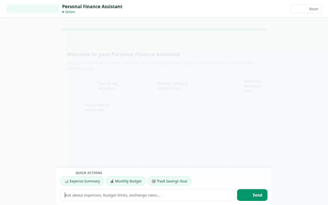

# Personal Finance Assistant

An intelligent personal finance companion built with Google's **Agent Development Kit (ADK)**, **Gemini Models**, **A2UI**, and **Google Cloud Services**.



---

## Overview

The **Personal Finance Assistant** helps users track expenses, monitor category budget limits, calculate spending breakdowns, check real-time foreign exchange conversion rates, run math & compound interest calculations, and generate visual savings milestone concept art.

It pairs an ADK backend agent running on **Agent Runtime** with an interactive **A2UI** frontend proxy that renders rich, dynamic financial cards for desktop and mobile.

---

## Features & Implemented Tools

### 📊 Expense & Budget Management
* **`get_recent_transactions`**: Queries recent expense transactions from **Google Cloud Firestore**, supporting category filtering (`Housing`, `Groceries`, `Utilities`, `Dining`, `Entertainment`).
* **`add_transaction`**: Log new expense records (description, amount, category, date, payment method) directly into Firestore.
* **`get_budget_summary`**: Aggregates total spending and calculates per-category spending breakdowns.
* **`set_category_budget_limit`**: Sets or updates monthly budget thresholds stored in Firestore.

### 💱 Foreign Exchange & Math Calculations
* **`get_exchange_rates`**: Retrieves live currency conversion rates for major world currencies (`USD`, `EUR`, `GBP`, `CAD`, `JPY`, etc.).
* **`calculate`**: Safely evaluates mathematical expressions for quick calculations.
* **`AgentEngineSandboxCodeExecutor`**: Executes Python code in a secure sandbox for complex budget projections and savings timelines.

### 🎨 Visual Savings Goals (A2UI & Image Generation)
* **`generate_goal_milestone_image`**: Uses `gemini-3.1-flash-lite-image` to generate custom financial goal milestone concept art, saving images as ADK artifacts and uploading them to a public **Google Cloud Storage** bucket.
* **A2UI (v0.8 Basic Catalog)**: Renders dynamic UI cards (`Card`, `Column`, `Row`, `Text`, `Image`) directly within the chat UI.

---

## Google Cloud Services Architecture

* **Google Cloud Firestore**: Persists transaction histories and category budget limits.
* **Google Cloud Storage**: Hosts public visual milestone images generated for financial savings goals.
* **Vertex AI / Gemini Models**:
  * `gemini-flash-latest` for conversational intelligence and tool calling.
  * `gemini-3.1-flash-lite-image` for visual concept generation.
  * `VertexAiMemoryBankService` for persistent agent memory.
* **Agent Engine / Agent Runtime**: Secure code sandbox execution and agent hosting.
* **Cloud Run**: Hosts the lightweight FastAPI chat proxy and responsive web frontend.

---

## Project Structure

```
.
├── app/
│   ├── agent.py               # Root ADK Agent, tools, system prompt, and A2UI callback setup
│   ├── a2ui_utils.py          # A2UI callback helper for formatting output parts
│   ├── fast_api_app.py        # ADK FastAPI application entrypoint
│   └── app_utils/             # Reasoning Engine and A2A protocol adapters
├── frontend/
│   ├── main.py                # FastAPI proxy connecting browser frontend to Agent Engine via A2A
│   ├── Procfile               # Cloud Run deployment instruction
│   └── static/
│       └── index.html         # Responsive Emerald-themed Chat UI with A2UI renderer & prompt chips
├── agents-cli-manifest.yaml   # Agent manifest configuration
├── deployment_metadata.json   # Deployment metadata and resource identifiers
├── agent_demo.webm            # Full HD screen recording of agent interaction
└── agent_demo.gif             # Embedded looping preview GIF
```

---

## Setup & Local Development

### Prerequisites

* Python 3.11+
* `uv` or `pip`
* Google Cloud CLI (`gcloud`) authenticated to a GCP Project with Firestore and Cloud Storage enabled.

### 1. Environment Setup

Clone the repository and install dependencies:

```bash
git clone <repository-url>
cd personal-finance-assistant
uv sync
```

### 2. Running the Agent Locally (ADK Playground)

To run the agent with the ADK web playground:

```bash
uv run adk web . --port 8080 --reload_agents
```

### 3. Running the Custom Frontend Proxy Locally

From the `frontend/` directory, set environment variables and start the server:

```bash
cd frontend
export AGENT_ENGINE_RESOURCE_NAME="projects/<PROJECT_ID>/locations/us-east1/reasoningEngines/<REASONING_ENGINE_ID>"
export AGENT_DIRECTORY="app"
uv run python main.py
```

Open `http://localhost:8080` in your web browser.

---

## Deployment

### Deploy Agent to Agent Runtime

```bash
agents-cli deploy --no-confirm-project
```

### Deploy Frontend to Cloud Run

```bash
cd frontend
gcloud run deploy personal-finance-assistant-frontend \
  --source . \
  --region us-east1 \
  --allow-unauthenticated \
  --set-env-vars AGENT_ENGINE_RESOURCE_NAME="<REASONING_ENGINE_RESOURCE_NAME>",AGENT_DIRECTORY="app"
```
